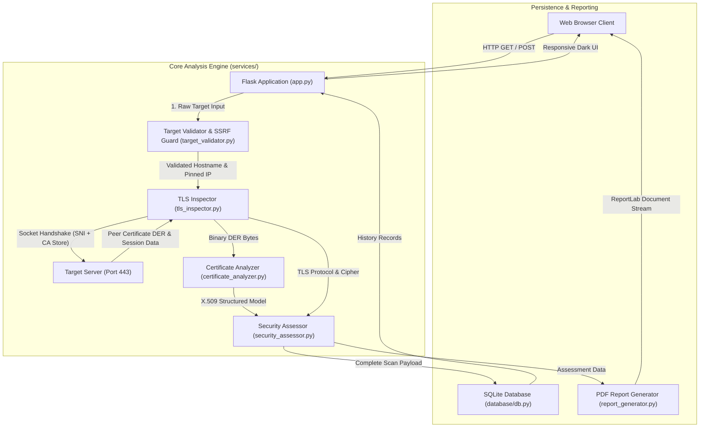
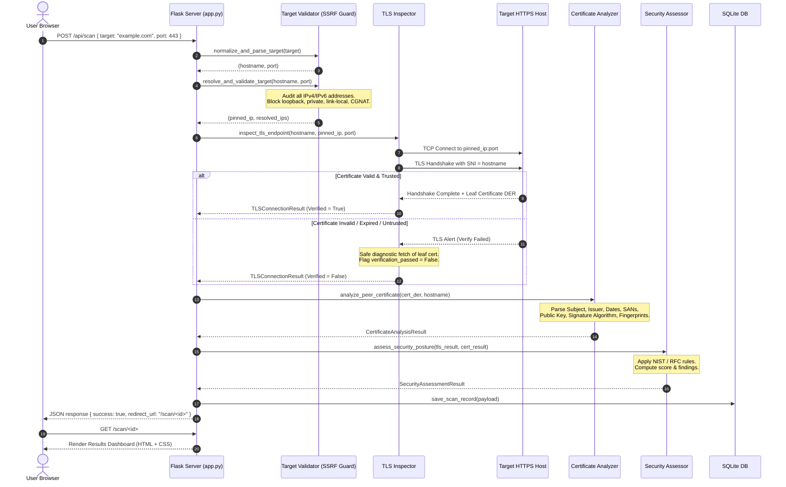

# TLScope: TLS Certificate and HTTPS Security Analysis Tool

An academic, production-grade cybersecurity tool built for **Computer Science Cryptography and Network Security** coursework and project viva examinations.

TLScope establishes genuine network socket connections, executes authentic TLS handshakes, parses binary X.509 ASN.1 DER certificates, verifies cryptographic trust chains, performs RFC 6125 hostname matching, deterministically evaluates security posture according to NIST SP 800-52r2 and RFC standards, generates downloadable PDF audit reports, and logs historical audits in a local SQLite database with comprehensive anti-SSRF protections.

---

## 1. Abstract

Modern internet security fundamentally relies on Transport Layer Security (TLS) and Public Key Infrastructure (PKI) to guarantee confidentiality, message integrity, and server authentication. However, many network administrators and software engineers mistakenly conflate possessing an active HTTPS padlock with total system security.

**TLScope** is an open-source, deterministic analysis platform designed to inspect live HTTPS endpoints without data fabrication. It evaluates real-world parameters including protocol downgrade resistance (TLS 1.2 vs 1.3), Authenticated Encryption with Associated Data (AEAD), Perfect Forward Secrecy (PFS), public key entropy, X.509 signature hash collision resistance, certificate validity lifespans, and Subject Alternative Name (SAN) hostname bindings. The tool provides transparent findings with evidence and remediation advice, printable PDF reports, and an educational scoring algorithm.

---

## 2. Problem Statement

1. **The "Green Padlock" Fallacy:** Non-technical users and developers frequently believe that any site serving traffic over port 443 with an active certificate is fully protected. In reality, obsolete protocols (TLS 1.0/1.1), weak cipher suites (CBC-mode ciphers susceptible to Lucky13/POODLE), or certificates expiring within days leave services vulnerable.
2. **Opaque Assessment Tools:** Commercial scanners often assign arbitrary letter grades or proprietary risk scores without explaining the underlying cryptographic mathematics or deterministic criteria.
3. **Lack of Educational Demonstration Tools:** Most student projects either produce static mockups or rely on third-party black-box APIs that cannot be demonstrated locally or tested against deliberate cryptographic edge cases (expired certificates, untrusted root authorities, or hostname mismatches).

---

## 3. Objectives

- **Live Handshake Telemetry:** Perform genuine TLS socket handshakes using Python's native `ssl` and `socket` modules, capturing negotiated parameters (protocol version, cipher suite, secret bits, ALPN).
- **Deep X.509 Certificate Inspection:** Parse DER-encoded certificates using the `cryptography` library to audit Subject DN, Issuer DN, validity windows, serial numbers, cryptographic key sizes, and SHA-256 fingerprints.
- **Trust Chain & Hostname Verification:** Validate trust chains against trusted Certificate Authority stores and enforce RFC 6125 identity matching without bypassing verification.
- **SSRF & DNS Rebinding Immunity:** Validate and pin resolved destination IP addresses before socket connection to prevent Server-Side Request Forgery against internal networks.
- **Deterministic Rules & Educational Scoring:** Implement rule-based evaluations following NIST SP 800-52r2, RFC 8446, and RFC 5280 with transparent deduction breakdowns.
- **Comprehensive Reporting & Audit History:** Generate audit reports via ReportLab and maintain scan summaries in a local SQLite database.

---

## 4. System Architecture

The application adheres to a modular design separating input validation, network inspection, cryptographic analysis, rule assessment, database persistence, and presentation.

### High-Level System Architecture



---

## 5. TLS Scanning & Analysis Workflow



---

## 6. Technology Stack

| Layer | Component | Version | Rationale |
|---|---|---|---|
| **Backend Framework** | Flask | 3.1+ | Lightweight WSGI microframework offering routing, template rendering, and application factory patterns without heavyweight overhead. |
| **Networking & TLS** | Python `ssl` & `socket` | 3.11+ | Standard library cryptographic socket implementation; communicates directly with system OpenSSL for real handshakes. |
| **Certificate Parsing** | `cryptography` | 50.0+ | Authoritative, memory-safe library for decoding ASN.1 DER X.509 certificates and extracting public keys and extensions. |
| **Report Generation** | ReportLab | 5.0+ | Engine for generating high-contrast, structured PDF documents in-memory. |
| **Database** | SQLite3 | 3.x | Lightweight embedded relational database utilizing parameterized SQL for local audit logging. |
| **Frontend Styling** | Bootstrap 5 + Custom CSS | 5.3 | High-contrast dark cybersecurity design system (`#070b14` navy/charcoal base with cyan, emerald, and amber accents). |
| **Testing** | `pytest` | 9.1+ | Automated test runner with fixtures for unit and integration testing. |

---

## 7. Directory Structure

```text
tlscope/
├── app.py                      # Application entrypoint & Flask routes
├── config.py                   # Application & testing configurations
├── conftest.py                 # Pytest sys.path setup
├── pytest.ini                  # Pytest settings
├── requirements.txt            # Python dependencies
├── run.bat                     # 1-Click setup & launch script for Windows
├── run.sh                      # 1-Click setup & launch script for macOS & Linux
├── LICENSE                     # MIT Open Source License
├── .env.example                # Example environment configuration
├── .gitignore                  # Git ignore rules
├── database/
│   ├── .gitkeep                # Directory marker for git
│   └── db.py                   # SQLite schema, queries & analytics
├── services/
│   ├── target_validator.py     # RFC 1123 normalization & SSRF IP pinning
│   ├── tls_inspector.py        # Real TLS socket inspection & HSTS probe
│   ├── certificate_analyzer.py # X.509 DER parsing & RFC 6125 SAN check
│   ├── security_assessor.py    # NIST/RFC scoring & 12 rule evaluations
│   └── report_generator.py     # ReportLab PDF report generation
├── static/
│   ├── css/style.css           # Futuristic Cyber-HUD design system
│   └── js/app.js               # Frontend controllers & Chart.js radar
├── templates/
│   ├── base.html               # Base layout & Cyber HUD navigation bar
│   ├── index.html              # Target input & Radar Sweep HUD animation
│   ├── results.html            # 6-Axis Radar chart, Chain tree & findings
│   ├── history.html            # Searchable audit log & analytics tiles
│   ├── pki_guide.html          # Educational PKI & cryptography guide
│   └── error.html              # Diagnostic error handler
├── test_fixtures/
│   └── cert_factory.py         # In-memory CA, leaf & self-signed cert factory
└── tests/                      # 38 passing unit, security & integration tests
├── README.md                   # Complete academic documentation
├── database/
│   ├── db.py                   # SQLite connection, schema, and queries
│   └── tlscope.db              # SQLite database (auto-generated at runtime)
├── services/
│   ├── target_validator.py     # Input normalization, RFC 1123, & SSRF defense
│   ├── tls_inspector.py        # Real TLS handshake, SNI, & diagnostic inspection
│   ├── certificate_analyzer.py # X.509 DER parsing & RFC 6125 hostname matching
│   ├── security_assessor.py    # Deterministic rule engine & educational scoring
│   └── report_generator.py     # ReportLab PDF report generation
├── templates/
│   ├── base.html               # Shared layout, navigation, & footer
│   ├── index.html              # Main dashboard, domain scanner, & PKI guide
│   ├── results.html            # Detailed scan results, telemetry tiles, & tabs
│   ├── history.html            # Scan history table & management
│   └── error.html              # Safe error presentation
├── static/
│   ├── css/
│   │   └── style.css           # Dark navy cybersecurity theme
│   └── js/
│       └── app.js              # Real-time scan submit, loading steps, & copy
├── test_fixtures/
│   ├── README.md               # Fixture documentation
│   └── cert_factory.py         # Dynamic X.509 test certificate generator
└── tests/
    ├── test_target_validation.py   # SSRF, IP checks, & input normalization tests
    ├── test_tls_inspector.py       # Socket timeout, refused, & SSL error tests
    ├── test_certificate_analysis.py# X.509 parsing, expiry, & SAN matching tests
    ├── test_security_assessor.py   # Deterministic rules & scoring tests
    ├── test_reports.py             # PDF generation tests
    └── test_routes.py              # Flask route, API, & header integration tests
```

---

## 8. Fundamental PKI and TLS Concepts (Viva Preparation)

### A. What TLS Does
Transport Layer Security (TLS) operates above the transport layer (TCP) and below the application layer (HTTP). It provides three foundational security guarantees:
1. **Confidentiality:** Encrypts data in transit using authenticated symmetric ciphers (e.g., AES-256-GCM, ChaCha20-Poly1305), ensuring eavesdroppers cannot inspect transmitted plaintext.
2. **Integrity:** Employs Message Authentication Codes (MAC) or Authenticated Encryption with Associated Data (AEAD) to ensure that any in-flight bit alteration is detected and rejected.
3. **Authentication:** Proves the identity of the remote server to the client using asymmetric cryptography and digital certificates, protecting against Man-in-the-Middle (MITM) attacks.

### B. What a Digital Certificate Is
An X.509 digital certificate is a standardized electronic credential that cryptographically binds a public key to an organization or domain name identity. It contains:
- **Subject:** The entity owning the public key.
- **Public Key:** The mathematical key used by clients to encrypt session parameters or verify digital signatures.
- **Validity Dates:** `Not Before` and `Not After` UTC boundaries defining the certificate's authorized lifetime.
- **Issuer:** The Certificate Authority that verified the subject's identity and digitally signed the certificate.
- **Signature:** A cryptographic hash of the certificate signed by the issuer's private key.

### C. How Certificate Chains Establish Trust
Web browsers cannot inherently know every website on earth. Instead, trust is established via a hierarchical chain:
- **Root CA:** A trusted root authority pre-installed directly into the operating system or browser trust store. Root certificates are self-signed.
- **Intermediate CA:** Issued and signed by a Root CA. Intermediates sign end-entity certificates. This isolates root keys offline in air-gapped hardware security modules (HSMs).
- **Leaf (End-Entity) Certificate:** The certificate presented by the target server during the TLS handshake.
The client validates trust by verifying signatures upward: `Leaf` $\rightarrow$ `Intermediate CA` $\rightarrow$ `Root CA`.

### D. Why Hostname Verification Matters (RFC 6125)
Possessing a valid, CA-signed certificate is completely insufficient if the certificate belongs to a *different* website. For example, if an attacker intercepts traffic to `bank.com` and presents a valid, trusted certificate for `evil-site.com`, a client that fails to perform hostname verification would accept the connection as "secure."
Under RFC 6125, clients must compare the requested domain name against the `Subject Alternative Name (SAN)` extension. If the hostname does not match any SAN, the handshake fails with an identity mismatch error.

### E. How TLS Versions are Negotiated
During connection setup:
1. **ClientHello:** The client sends supported TLS versions, a list of supported cipher suites, key share parameters, and the `Server Name Indication (SNI)` extension specifying the target domain.
2. **ServerHello:** The server selects the highest mutually supported TLS protocol version and compatible cipher suite.
3. Modern implementations prioritize **TLS 1.3 (RFC 8446)**, which eliminates obsolete algorithms (RSA key exchange, CBC ciphers, RC4, MD5, SHA-1), mandates Perfect Forward Secrecy, and completes the handshake in a single round-trip (1-RTT).

### F. Why Certificate Validity Alone Does Not Prove Complete Security
A website with a valid, trusted certificate can still be severely vulnerable if:
- The server supports deprecated fallback protocols (TLS 1.0 or 1.1) subject to downgrade attacks.
- The server negotiates non-PFS ciphers, allowing an adversary who records encrypted traffic today to decrypt all past communications if the server's private key is ever compromised in the future.
- The server fails to implement HTTP Strict Transport Security (HSTS), leaving users vulnerable to SSL stripping attacks on initial plaintext HTTP requests.

---

## 9. Security Implementations & SSRF Protections

Because TLScope accepts user-supplied hostnames and establishes raw socket connections, it implements multi-layered defensive security measures:

1. **SSRF Prevention:**
   - Every user input is parsed and stripped of command delimiters, unexpected schemes, embedded credentials, and paths.
   - All resolved IPv4 and IPv6 addresses are inspected against prohibited ranges:
     - Loopback (`127.0.0.0/8`, `::1`)
     - RFC 1918 Private networks (`10.0.0.0/8`, `172.16.0.0/12`, `192.168.0.0/16`)
     - Link-Local / Cloud Metadata (`169.254.0.0/16`, `fe80::/10`)
     - Multicast (`224.0.0.0/4`, `ff00::/8`)
     - Carrier-Grade NAT (`100.64.0.0/10`)
     - IPv4-mapped IPv6 addresses (`::ffff:127.0.0.1`)
2. **DNS Rebinding & TOCTOU Protection (Destination IP Pinning):**
   - The scanner does not allow the operating system to re-resolve the domain name during socket creation. The application validates the IP address and connects directly to the pinned IP (`sock.connect((pinned_ip, port))`), passing the original validated hostname into `context.wrap_socket(sock, server_hostname=hostname)` for SNI and certificate validation.
3. **Explicit Socket & Network Timeouts:**
   - Explicit connect and read timeouts (default 6.0 seconds) prevent denial-of-service via slowloris or tarpit endpoints. Network resources are safely closed in `finally` blocks.
4. **Parameterized SQL Queries:**
   - All SQLite queries use parameterized bindings (`?`) to prevent SQL injection.
5. **Hardened HTTP Response Headers:**
   - `Content-Security-Policy`: Restricts scripts and styles to self and vetted CDNs.
   - `X-Content-Type-Options: nosniff`: Prevents MIME-type sniffing.
   - `X-Frame-Options: DENY`: Prevents clickjacking.
   - `Referrer-Policy: strict-origin-when-cross-origin`.

---

## 10. Installation & Execution Guide

TLScope is designed to run seamlessly on **Windows, macOS, and Linux** with zero configuration.

### Prerequisites
- **Python 3.10+** (Python 3.11 or 3.12 recommended)
- `git` (or simply extract the ZIP archive)

---

### Option A: 1-Click Launch (Recommended)

#### On Windows:
Double-click `run.bat` or run in terminal:
```cmd
.\run.bat
```
*(Automatically creates `.venv`, installs dependencies quietly, starts server at `http://127.0.0.1:5000`, and opens your default browser.)*

#### On macOS / Linux:
Make the script executable once and run:
```bash
chmod +x run.sh
./run.sh
```

---

### Option B: Manual Terminal Setup

#### 1. Clone or Extract the Repository
```bash
git clone https://github.com/<your-username>/tlscope.git
cd tlscope
```

#### 2. Create and Activate a Virtual Environment

**Windows (PowerShell):**
```powershell
python -m venv .venv
.\.venv\Scripts\Activate.ps1
```

**macOS / Linux (Bash / Zsh):**
```bash
python3 -m venv .venv
source .venv/bin/activate
```

#### 3. Install Dependencies
```bash
pip install -r requirements.txt
```

#### 4. Run Automated Tests
Verify all 38 tests pass on your machine:
```bash
pytest -v
```

#### 5. Launch Application
```bash
python app.py
```
Open **http://127.0.0.1:5000** in your browser.

- **Live Scanner:** `http://127.0.0.1:5000/`
- **Audit Log Workspace:** `http://127.0.0.1:5000/history`
- **PKI Cryptography Guide:** `http://127.0.0.1:5000/pki-guide`

---

## 11. Testing and Verification Results

The automated test suite covers unit, security, and integration scenarios across all modules:

```text
============================= test session starts =============================
platform win32 -- Python 3.11.4, pytest-9.1.1
rootdir: C:\Users\Seshan K\.gemini\antigravity\scratch\tlscope
configfile: pytest.ini
testpaths: tests
collected 38 items

tests/test_certificate_analysis.py::test_analyze_valid_certificate PASSED
tests/test_certificate_analysis.py::test_analyze_expired_certificate PASSED
tests/test_certificate_analysis.py::test_hostname_matching_rfc6125 PASSED
tests/test_certificate_analysis.py::test_missing_or_corrupt_certificate_der PASSED
tests/test_certificate_analysis.py::test_certificate_chain_hierarchy_and_self_signed PASSED
tests/test_reports.py::test_pdf_generation_complete_data PASSED
tests/test_reports.py::test_pdf_generation_missing_cert PASSED
tests/test_routes.py::test_index_route PASSED
tests/test_routes.py::test_history_route PASSED
tests/test_routes.py::test_health_endpoint PASSED
tests/test_routes.py::test_security_headers_enforcement PASSED
tests/test_routes.py::test_scan_api_validation_error PASSED
tests/test_routes.py::test_scan_api_ssrf_blocked PASSED
tests/test_routes.py::test_scan_api_success_and_retrieval PASSED
tests/test_routes.py::test_clear_history_api PASSED
tests/test_routes.py::test_404_handling PASSED
tests/test_routes.py::test_pki_guide_route PASSED
tests/test_routes.py::test_history_stats_api PASSED
tests/test_routes.py::test_delete_individual_scan_api PASSED
tests/test_security_assessor.py::test_assessment_connection_failure PASSED
tests/test_security_assessor.py::test_assessment_strong_tls_posture PASSED
tests/test_security_assessor.py::test_assessment_expired_certificate_failure PASSED
tests/test_security_assessor.py::test_assessment_expiring_soon_warning PASSED
tests/test_security_assessor.py::test_assessment_deprecated_protocol PASSED
tests/test_security_assessor.py::test_assessment_hsts_findings PASSED
tests/test_security_assessor.py::test_assessment_pfs_findings PASSED
tests/test_target_validation.py::test_normalize_valid_hostnames PASSED
tests/test_target_validation.py::test_reject_unsupported_schemes PASSED
tests/test_target_validation.py::test_reject_embedded_credentials PASSED
tests/test_target_validation.py::test_reject_command_injection_and_invalid_chars PASSED
tests/test_target_validation.py::test_invalid_ports PASSED
tests/test_target_validation.py::test_ssrf_prohibited_ips PASSED
tests/test_target_validation.py::test_dns_resolution_failure PASSED
tests/test_target_validation.py::test_ssrf_blocking_during_dns_resolution PASSED
tests/test_target_validation.py::test_pinned_ip_selection PASSED
tests/test_tls_inspector.py::test_inspect_connection_timeout PASSED
tests/test_tls_inspector.py::test_inspect_connection_refused PASSED
tests/test_tls_inspector.py::test_inspect_cert_verification_failure PASSED

============================= 38 passed in 1.72s ==============================
```

---

## 12. College Viva Demonstration Guide

When presenting TLScope during your academic viva examination, follow this demonstration workflow:

1. **Architecture & Philosophy Overview (1 minute):**
   - Explain that TLScope performs genuine TLS socket connections without simulated or mocked scan results.
   - Show the terminal and run `python -m pytest -v` to prove that all 32 unit and integration tests pass.
2. **Standard Secure Domain Audit (1 minute):**
   - Enter `cloudflare.com` or `google.com`.
   - Point out the negotiated **TLS 1.3** protocol, the **AEAD cipher** (`TLS_AES_256_GCM_SHA384`), and the **Perfect Forward Secrecy (PFS)** badge.
   - Switch to the **Certificate Identity** tab to show the Subject, Issuer, and the Subject Alternative Names (SANs) verifying RFC 6125 compliance.
3. **SSRF Defense Demonstration (1 minute):**
   - In the input field, submit `127.0.0.1` or `http://169.254.169.254` (cloud metadata address).
   - Show how the backend intercepts the request and produces a security error (`[SSRF_VIOLATION]`), explaining how IP resolution and destination pinning prevent DNS rebinding and internal network scanning.
4. **Downloadable PDF Assessment (30 seconds):**
   - Click the **Download PDF Report** button.
   - Open the resulting PDF to showcase the executive summary, findings table with remediation advice, and academic disclaimer generated by ReportLab.
5. **Scan History & Persistence (30 seconds):**
   - Navigate to the **Scan History** tab. Show how previous scans are persisted in the SQLite database with their findings counts, outcomes, and scores.

---

## 13. Known Limitations

- **Certificate Chain Discovery:** Standard Python `ssl` client sockets only expose the end-entity (leaf) certificate via `getpeercert()`. In accordance with RFC integrity requirements, TLScope evaluates the full chain validity authoritative status reported by OpenSSL during the handshake, but does not simulate or invent unseen intermediate certificates.
- **Port Flexibility:** To prevent arbitrary port scanning via SSRF, the application restricts scans to standard HTTPS ports (`443`, `8443`, `4433`, `9443`).

---

## 14. Conclusion

TLScope provides a transparent, standards-compliant, and secure analysis platform for evaluating TLS certificates and HTTPS network configurations. By combining defensive security engineering (anti-SSRF, IP pinning, safe headers) with strict cryptographic analysis, it serves as an exemplary academic project demonstrating real-world Computer Science Network Security principles.
